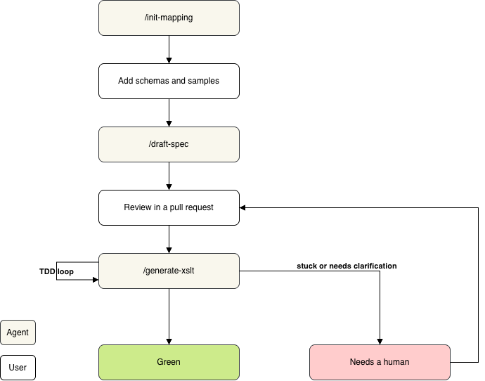

Up until two years ago I would spend a great deal of time developing data mappings. Most of it was fairly repetitive work with the occasional challenge. Since the dawn of the LLMs I've noticed a decline in demand for this type of work. Some customers are happy asking an LLM to write a script to solve their issue quickly without the costs of an external consultant. While it initially sucks that customers sometimes think they don't need me anymore, I've spent a great deal of my career automating work, so it was inevitable that it would include some of my own one day. And in my <a href="/posts/camel-kit-sandbox/index.html" target = "_self">last post</a> about building integrations with agents I showed that a working data mapping is easily generated, provided that you have the right inputs. 
 
Recently a customer reached out to me saying that they have experimented with AI for data mapping and they find it does pretty well. An LLM can very quickly produce a working transformation based on a couple of schemas and sample files. The problem was that everyone did it slightly differently. Some used AI from the terminal in a repo with loads of markdown files and others copy-pasted from a chat window. And existing mappings were already a mix of XSLT 2.0, scripts and templating engines.

While the results worked, it was not exactly clear *why* a mapping did what it did or which business rules it captured. Nor was it clear how changes were implemented. 

The question was: How can we get the team to work the same way, transparently, and ensure that the outcomes have a certain quality? 

### The workflow
We decided to run a pilot with a new way of working. This is of course subject to change but I thought it might be worth sharing. Here's our AI data mapping workflow:



From a bird's-eye view we took some ideas from [spec-driven development](https://github.com/github/spec-kit#spec-driven-development) workflows. In this case the workflows are guided by Claude Code and a certain set of [skills](https://code.claude.com/docs/en/skills) to ensure each step has the same instructions & [hooks](https://code.claude.com/docs/en/hooks-guide) for running scripts and preventing certain actions.

1. The first step for a new mapping is kicking off the skill `/init-mapping`. An agent will then ask some specific questions about the domain and scaffold the project's files and folders. This includes directories for the sample files, tests, schemas and output and a skeleton of the spec. All in a structure that makes sense for the customer.
2. Next a team member adds the schemas and samples with expected inputs and outputs.
3. Each mapping needs a spec which is regarded as the source of truth and is later used to generate the XSLT. `/draft-spec` generates a draft version. The goal is to create a reasonable starting point that must be reviewed by a team member. The agent looks at the sample files and drafts every target field as proposed. Every proposed field says what it's derived from. If the samples don't explain a value, the agent asks questions and if the answers are still unclear then it will leave actions behind in the spec to resolve during the review step. Here's a trimmed example of a spec:
   ```markdown
   ---
   source_format: json
   source_schema: schemas/webshop-order.json
   target_format: xml
   target_schema: schemas/sales-order.xsd
   ---
   # Webshop order to sales order

   ## General rules
   - JSON fields are dot paths with [] after each array, for example order.lines[].quantity.
   - Calculated amounts are rounded to 2 decimals, half up. Copied values are never rounded.

   ## Value maps
   | order.payment_method | paymentTerms |
   | -------------- | ------------ |
   | CARD           | PREPAID      |
   | INVOICE        | NET30        |

   ## Fields
   ### /salesOrder/customerReference
   - **Status:** agreed
   - **Source:** `order.id`
   - **Rule:** Copy the webshop order id.

   ### /salesOrder/discountPercentage
   - **Status:** proposed
   - **Source:** `order.coupon_code`
   - **Rule:** 10 when the coupon starts with `VIP`, otherwise 0.
   - **Evidence:** matches samples 1 and 3.
   - **Question:** sample 2 has coupon `SUMMER24` with a 15% discount. Is there a coupon table?
   ```

4. This is the moment where the AI's understanding of the mapping is reviewed and steered. A team member reviews the draft, clears up any misunderstandings, adds extra context and makes a definitive version ready in a pull request. This ensures that changes show up as readable diffs and that it's easy for the team to review what the incoming changes are. 
5. Once the spec is approved it's handed off to `/generate-xslt`. This kicks off a test & development loop that eventually produces the right XSLT or ends with _needs a human_. This skill has multiple phases:
	1. The spec gets checked for blockers. Generation refuses to start if any field is still proposed or any question is open. 
	2. The agent writes tests in [XSpec](https://github.com/xspec/xspec) which is a testing framework for XSLT. Each sample file pair gets a test and so does each rule that's more than a 1-on-1 mapping. Value-maps or decision-table rows also get a separate test. The idea behind this is that it's simpler to verify a test file that has mostly rules for the exceptions instead of tests for each field. And we trust that the sample files cover the simple 1-on-1 mappings. 
	3. Write & test the stylesheet. The agent takes the tests, spec and our conventions and produces an XSLT file. It then runs the test suite and corrects any errors automatically. This part has hooks set up for running the test suite and file protections so that the agent can't cut corners and edit the tests itself to make them green. 
	4. If within a certain number of loops the agent is unable to produce green tests, it will end with _needs a human_, write a report with its reasoning and go back to the review step.

### The principles behind it
1. One format: XSLT 3.0 for both JSON and XML. It's proven itself in the Azure Logic Apps and Apache Camel worlds, and the team only has to know one thing. 
2. The spec is the source of truth. Nobody edits the XSLT by hand. To change a mapping you change the spec, so there's one thing to keep up to date and every change is a readable diff.
3. Only a human can approve a rule. The agent drafts every rule from evidence like _matches in samples 1 and 3_ and asks when the samples don't explain a value. A person sets each rule to agreed. The agent never signs off on its own work.
4. Tests come first. They're written from the spec and samples without looking at the stylesheet. A test copied from the code proves nothing.
5. The agent can't move the goalposts. The spec, samples, expected outputs and schemas are read-only, and the tests lock once the write-and-test loop starts. So a test can't be made to pass by changing what it checks.
6. The agent fixes its own mistakes and not the business's. A wrong path or namespace gets retried. If the spec and an expected output disagree then it stops and asks.
7. Tests run like production. They use the same XSLT engine and Java version as the integration platform and are triggered by one command for people, the agent and future CI. 

So what about updates? These are also handled by `/generate-xslt`, which checks if it's a new mapping or an existing one. If it's an existing one it performs a diff and only patches the new tests and relevant parts of the XSLT. 

And that's it! Using this workflow we've been able to re-create some mappings with business rules in them that work. There are some things that I'd still like to add, like a proper CI pipeline and maybe generating a visual overview of a mapping using the format of a data mapper like Kaoto.  

I'm curious, have you looked at AI for creating data mappings? What were your experiences? I'd love to [hear your thoughts](https://data-integration.dev/contact/)! And if your team could use a hand setting up a workflow like this, I'm available for freelance work within the EU. This is the kind of work I enjoy doing.

<small>This article was written with the assistance of AI. </small>


